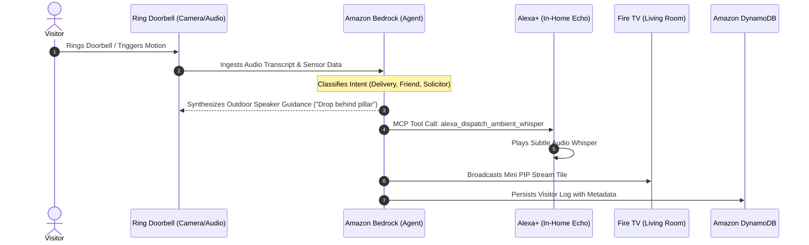

# 🏗️ Architecture & Cross-Device Dataflow

**Ring Concierge AI** is built on an event-driven, multi-device architecture connecting:
* **Ring Video Doorbell API / Webhooks**
* **Amazon Bedrock (Claude 3.5 Sonnet Reasoning)**
* **Alexa+ Agent Skills via Model Context Protocol (MCP)**
* **Fire TV Picture-in-Picture Broadcast**
* **Amazon DynamoDB Event Ledger**

---

## 🔁 Complete Event Lifecycle

---

## 🛠️ MCP Tool Definitions for Alexa+
The system exposes standard **Model Context Protocol** tools to allow the homeowner to have bidirectional conversations with their home:
* `ring_get_last_visitor`: Allows asking *"Alexa, who was at the door?"*
* `alexa_dispatch_ambient_whisper`: Controls non-intrusive ambient speech across specific rooms.
* `firetv_trigger_picture_in_picture`: Opens or closes the mini-camera view without pausing active media playback.
